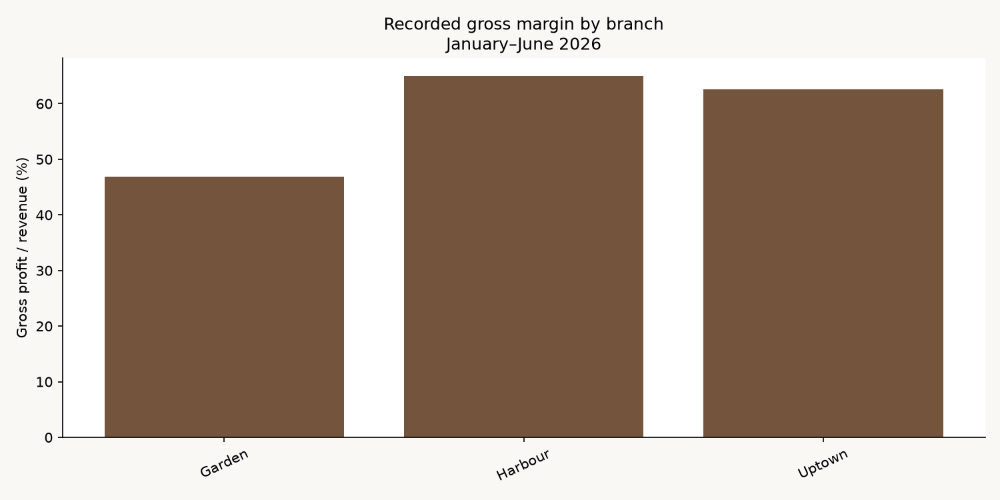

<div align="center">

# Stories Coffee

**Sales analysis & seven recommendations for better business decisions**

Garden · Harbour · Uptown<br>
EECE 490 Hackathon · January–June 2026

[Findings](#key-findings) · [Recommendations](#recommendations) · [Dashboard](#dashboard) · [Setup](reports/project_guide.md#how-to-run)

</div>

## Project background

We analyzed six months of Stories Coffee transactions to understand branch profitability, busy hours and promotion opportunities. Python analysis, a Streamlit dashboard and scenario simulations turn those findings into small, measurable tests.

## Data at a glance

| Branches | Products | Item lines | Baskets |
| :---: | :---: | :---: | :---: |
| 3 | 45 | 51,177 | 33,887 |

**Revenue:** $305,925.14 &nbsp; · &nbsp; **Recorded gross profit:** $179,430.49

Totals cover January 1–June 30, 2026 across all three branches. Baskets can contain multiple item lines. Gross profit excludes payroll, rent and other operating expenses.

## Key findings

- **Garden’s costs need a closer look.** Recorded margin is 46.91%, versus Harbour’s 64.96%. Matching Harbour’s product costs at Garden’s actual quantities creates a **$15,923.47 six-month GP difference**. Cash savings depend on invoice verification.
- **Evenings drive the business.** 19:00–23:59 accounts for **44.6% of recorded GP**. The 21:00 hour has 4,273 baskets across the six months, versus 724 at 07:00.
- **Larger discounted baskets do not prove an offer works.** Existing comparisons cannot identify incremental demand. Weather features also failed to improve the repository’s May–June forecast check.



## Recommendations

| | Action | First step |
| :---: | :--- | :--- |
| **01** | **Audit Garden’s costs** | Trace the top five cost-gap contributors to invoices before changing suppliers. |
| **02** | **Plan by the clock** | Match preparation and coverage to branch/hour demand. |
| **03** | **Test discounts in quiet periods** | Randomize no offer, 10% and 15% before purchase; include nonbuyers. |
| **04** | **Ask “want a pastry?”** | Test a full-price evening prompt with cold coffee; monitor queues. |
| **05** | **Test a 5% price rise** | Start at one branch with concurrent controls; track whole-basket contribution. |
| **06** | **Test opening later** | Confirm removable staff hours before trying Uptown at 09:00 and Garden at 08:00. |
| **07** | **Hold unsupported promotions** | Require incremental contribution before seasonal, late-evening or bundle rollouts. |

**Simulation context:** a chain-wide +5% price scenario gives median six-month GP gain **$7,305** (P5–P95: $3,025–$11,128). The three early branch-hour closures give median **$656 over 182 days** (−$807 to +$2,315), positive in 75.2% of draws. Both use 20,000 draws, seed 490. These are assumption-based scenarios, not proven gains or one-branch pilot forecasts.

**Scale only when contribution after extra costs improves and service stays healthy.** Stop for quality or queue breaches, or if realized costs erase the benefit. No commercial pilot has occurred. [Assumptions, evidence and individual stop rules →](reports/recommendations_guide.md)

## Dashboard

Explore sales, profitability, forecasts and editable scenarios in **Streamlit**. Use Python 3.14 and place the authorized `stories_transactions.csv` at the repository root.

```sh
python3 -m venv .venv
.venv/bin/python -m pip install -r requirements.txt
.venv/bin/python -m streamlit run app.py
```

[Full setup & reproducibility](reports/project_guide.md#how-to-run) · [Decision notebook](colab_recommendations/Stories_Coffee_Decision_Lab.ipynb) · [Feature notebook](notebooks/feature_effects.ipynb) · [Verification](reports/verification.md)