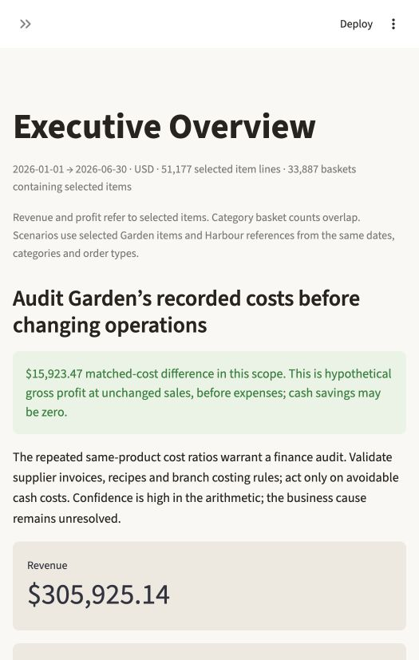

# Stories Coffee — Turning Transactions into Profitable Decisions

**Audit Garden’s costing rule before changing procurement.** Garden records a **46.91% gross margin**, compared with Harbour’s **64.96%**. Matching identical products at Harbour’s recorded costs creates a **$15,923.47** six-month gross-profit difference at Garden’s actual quantities. This is a counterfactual, not established cash savings. The [CEO report](reports/executive_summary.md) explains the decision, competing explanations and go/no-go conditions.

## Top 5 actions

1. **Audit Garden's costs.** Garden's recorded costs run about 43% above Harbour's on the same 45 products, which is worth **$15.9K of gross profit over six months** if the difference is real.
2. **Staff and prep for the evening peak.** 19:00–23:59 brings in **44.6% of gross profit** in every branch. Plan rosters from `reports/tables/staffing_template.csv`.
3. **Suggest a bakery item with matcha, with no discount.** The pair is bought together **1.7× more often than chance**. A 3% attachment adds about $393; giving a 10% rebate on the same pairing turns that into a $497 loss.
4. **Don't roll out blanket discounts.** Raw discount "uplift" is largely a selection artefact. Run a randomized 0/10/15% test first.
5. **Ignore the weather when planning.** Demand follows the clock, not the temperature: rain, heat, holidays and Ramadan show no reliable effect.

**No product needs to be cut.** Unlike shops with an obvious laggard, Stories' weakest product, Sparkling Water, still earns 0.74% of gross profit, and the bottom five are menu staples (waters, Espresso, English Breakfast Tea). They mostly sell alongside other items (63% of Sparkling Water baskets contain something else), so removing them risks losing the whole basket. The lower-margin items worth reviewing are Sparkling Water (45% margin), Granola Yoghurt (53%) and Soup of the Day (56%). Check their recipe and waste costs before changing them.

Evidence, caveats and stop rules for each action are in the reports below.

## Business question

Why is Garden’s recorded profitability lower, and which intervention can improve contribution without paying for demand that would have happened anyway?

## Key findings

- **Systematic cost pattern:** all 45 products occur at all branches. Costs remain constant within every product/branch combination; Garden/Harbour ratios are near 1.43. Verify invoices, recipes and allocation rules before attributing this to inefficiency.
- **Financially meaningful but conditional:** 25–100% recovery corresponds to **$3,980.87–$15,923.47**, before implementation expense, with unchanged sales. An accounting-only difference could yield zero cash savings.
- **Discount selection matters:** the existing [discount study](analysis/outputs/REPORT.md) shows that an “any discounted item” basket definition can mechanically select larger baskets. Co-purchase evidence likewise does not establish incremental cross-sell response. Do not scale promotions from raw basket averages.

The [deep decision research](reports/deep_insights.md) adds three investigations: evening hours account for 44.6% of recorded GP; 99.2% of the January-to-June GP/day increase is attributable arithmetically to more baskets/day; and matcha + bakery pairs occur 1.76× / 1.72× more often than a basket-size/context null predicts in the two chronological periods. A no-discount attachment pilot is more defensible than blanket rebates, whose leakage can exceed modeled incremental contribution. These are exploratory diagnostics and scenarios, not causal treatment estimates.

The [causal decision brief](reports/causal_decisions.md) follows six possible intervention chains through to contribution, customers and service. New financial gates show why whole-basket losses matter: Sparkling Water's modeled price alignment tolerates 14.8% item-only loss but just 4.85% containing-basket loss. A 3% incremental evening attachment scenario adds $212 before costs; about 40 representative lost evening baskets erase it. The pathways are hypotheses, not identified causal effects. All 45 product price gates, operating-loss sensitivities, unresolved links and experiment stop rules are exported.

Observed January–June 2026: **51,177 item lines, 33,887 baskets, $305,925.14 revenue and $179,430.49 recorded GP**. Gross profit excludes operating expenses. [Machine-readable reconciliation](reports/data_quality.json) distinguishes baskets, lines, missing IDs, duplicates and half-cent rounding checks.

## External factors: weather, holidays, Ramadan, payday

These 81 columns are not in the source file. We added Beirut weather by day and by transaction hour (Open-Meteo ERA5); hourly dust, PM and AQI (Open-Meteo CAMS); Lebanese holidays, bridge days, long weekends, school breaks, Ramadan and iftar, and payday; and features derived from the transactions themselves (daypart, basket composition, branch load, customer visit history). **None of them explains demand in a way Stories can act on.** With branch × weekday and trend controls, the rain, temperature, holiday and Ramadan effects on daily baskets all have 95% intervals that include zero, and adding these features makes May–June forecasts slightly worse (overfitting). The cold-drink share of drinks stays near 60% from January (14°C) to June (25.5°C). That is a realism flag to raise with the data team, and a reason not to fund weather-driven staffing. The one weak signal is a month-start lift (+2.8% in holdout, after a +9.3% training estimate) that should be retested before anyone uses it for rosters. See the [external-factors report](reports/external_factors.md).

**Feature loop result: demand is set by the clock, not the sky.** An eight-round feature loop ([log](reports/feature_loop.md)) ends in a single result. A branch × hour × weekday template plus growth predicts unseen May–June branch-hours to within about 1% of the Poisson noise floor, with holdout dispersion around 1.0. No further feature can add much. Dine-in jumps from 46% to 72% at 18:00 and cold-drink share steps at 11:00 and 19:00, in every month and branch, regardless of sunset or temperature. Iced drinks are an evening occasion, not a heat response. Plan ice, prep, desserts and seats by the hour, and staff from `reports/tables/staffing_template.csv`.

## Sales forecast (machine learning)

**If the January–June growth path holds, plan for about $67.4K revenue in July and $70.6K in August** (80% bands $64.3K–$69.1K and $67.4K–$72.4K), with gross profit around $39.5K and $41.5K. Six models are compared in a rolling-origin backtest: seven origins, 28 days ahead, scored on every branch-day. The models are a seasonal-naive benchmark, a log-linear clock template, a regularized Poisson GLM, a gradient-boosted hybrid, an additive linear-trend × weekday model and an ensemble. The linear-trend model wins on revenue, gross profit and baskets. It is 15–17% more accurate than the naive benchmark, has about 4% weekly error and +0.5% bias. The log-link models over-forecast because growth here is additive, not compounding. Gradient boosting adds nothing beyond branch × weekday × trend. See the [forecast report](reports/forecasting.md), the **Sales Forecast** dashboard page and `reports/tables/forecast_*.csv`. Six months cannot reveal seasonality; re-fit after each month closes.

## Financial impact and recommended actions

Start with a finance audit of the largest dollar contributors, including Iced Matcha and Chicken Pesto Sandwich. Confirm that matched-cost differences are avoidable cash expenses. Pilot verified changes with quality controls; reject changes whose verified benefit does not cover implementation expense and operational risk. Compare doing nothing, a targeted audit, price adjustments and promotion experiments in the [validation plan](reports/experiment_plan.md).

The interactive simulator exposes cost recovery, proportional portfolio coverage, price adjustment, demand loss and implementation expense. It calculates a historical baseline, scenario GP, net benefit and break-even demand loss. Scenarios are not forecasts. [All product opportunities](reports/tables/matched_products.csv) and [recovery scenarios](reports/tables/cost_scenarios.csv) are reproducible.

## Dashboard

Eleven pages: Executive Overview; Causal Decision Chains; Deep Decision Insights; Sales & Transactions; Profitability Investigation; Sales Forecast; Opportunity Simulator; Basket & Promotion Opportunities; Weather & Calendar; Feature Explorer; Evidence, Limitations & Assumptions. Branch, date, category and order-type filters recalculate the charts. Basket analysis restores complete baskets containing selected items; financial summaries use selected item lines and label their denominators.



The sales page reconstructs the reference’s two-by-two arrangement: monthly revenue, weekday baskets, hourly baskets and horizontal category bars, with synchronized branch filtering. All counts are adapted to Stories’ line-item transaction format.

## Methodology

[Detailed methodology](reports/methodology.md), [full analysis](reports/full_analysis.md), [assumptions and competing hypotheses](reports/assumptions_and_limitations.md), and [reference inspection](reports/reference_implementation.md).

The pipeline validates financial arithmetic, preserves uncertain duplicates, aggregates baskets, compares identical products, standardizes product mix and computes an exact Shapley GP/unit bridge across mix, price, discounts and costs. Pairs use Jan–Apr training support and May–Jun validation. Financial simulations disclose constant-mix and demand assumptions. No ML is needed for these arithmetic decisions; ML is used only for the sales forecast. The existing discount study adds date-cluster uncertainty and exposure-selection diagnostics.

## Project structure

- `app.py`: Streamlit interface; `src/analytics.py`: dashboard-independent calculations.
- `src/feature_effects.py`: feature catalog and the raw-vs-controlled effect engine behind the Feature Explorer and notebook (`reports/tables/feature_effects.csv`).
- `notebooks/feature_effects.ipynb`: every feature and its effect, with saved outputs. It runs locally or in Colab (upload `dist/stories-coffee-source.zip` and the CSV when prompted). Rebuild with `python scripts/build_notebook.py --execute`, which needs `pip install nbformat nbclient ipykernel`.
- `src/features.py`: weather/calendar enrichment and context models; `data/external/`: Beirut weather and Lebanese calendar (no transaction data); `scripts/fetch_external.py` re-downloads the weather.
- `scripts/run_analysis.py`: tables, static figures and computed CEO/full reports.
- `src/forecasting.py`: forecasting models, rolling-origin backtest and calibrated intervals; `scripts/forecast.py` writes `reports/forecasting.md`, `figures/forecast.png` and `tables/forecast_*.csv`.
- `reports/`: aggregate evidence, financial scenarios, methodology, attribution and pilot plan.
- `tests/`: financial, transaction-grain, scope, dashboard and deeper null-model/growth checks.
- `analysis/`: preserved detailed discount investigation and its tests.
- `simulator/`: preserved standalone browser strategy simulator and model checks.
- `database/`: existing SQLite build script, schema and example business queries. `database/add_features.py` adds `context_daily`, `context_hourly`, `line_features` and the `transactions_enriched` view, writes `stories_transactions_enriched.csv` (raw records, git-ignored), and runs `feature_queries.sql`.

## How to run

Use Python **3.14** for the exact tested dependency pins. Place the authorized `stories_transactions.csv` at the repository root; no API keys are needed.

```sh
python3 -m venv .venv
.venv/bin/python -m pip install -r requirements.txt
.venv/bin/python scripts/fetch_external.py   # optional: data/external/ is already included
MPLCONFIGDIR=/tmp/stories-mpl .venv/bin/python scripts/run_analysis.py
MPLCONFIGDIR=/tmp/stories-mpl .venv/bin/python scripts/forecast.py   # backtest + Jul–Aug forecast
.venv/bin/python database/build_database.py && .venv/bin/python database/add_features.py   # SQLite + enriched CSV
.venv/bin/python -m unittest discover -s tests -v
.venv/bin/python -m streamlit run app.py --server.address 127.0.0.1 --server.port 8501 --browser.gatherUsageStats false
```

Open [the dashboard](http://127.0.0.1:8501). To validate the existing discount investigation without overwriting its saved evidence:

```sh
OPENBLAS_NUM_THREADS=1 .venv/bin/python analysis/run_analysis.py --output /tmp/stories-discount-check
.venv/bin/python -m unittest discover -s analysis -v
```

See [analysis-specific reproducibility details](analysis/README.md), [standalone simulator instructions](simulator/README.md), and [verification results](reports/verification.md). Report figures and CSVs rebuild without Streamlit. `--source` and `--output` select authorized inputs and output directories.

## Limitations and publication status

No supplier invoices, waste logs, labor costs, elasticity or nonbuyer conversion are available. Customer IDs are missing on about 36.5% of baskets. Keep all 132 excess duplicate-looking rows pending source verification; duplicate sensitivity is reported. Category/context and growth studies are retrospective; chronological replication is not prospective validation. Optional Excel workbook/native PivotTables and notebooks are not delivered; the working Streamlit application provides the interactive experience.

**Do not publish this checkout as-is.** Raw CSV and database/SQL exports were already tracked before this work. `.gitignore` now excludes them from new additions but does not remove existing Git history or tracked entries. Confirm data-sharing permission or prepare a separate clean source-only repository excluding raw/derived transaction data and history. Nothing was pushed or published during this work.

`python scripts/package_submission.py` creates `dist/stories-coffee-source.zip`, an allowlisted source/aggregate-only archive without the raw CSV, transaction databases, SQL dumps, upstream clone or Git history. Extract this archive to prepare a clean submission repository; authorized reviewers supply the CSV locally to reproduce the analysis.

## Team

Team member names were not supplied. Add the actual contributors before submission; no identities have been invented.

## References and reuse

[Abel Atangs — coffee-shop-analytics](https://github.com/atangsabel13/coffee-shop-analytics), inspected at commit `2b044959782783c2ab542657a84d6e45c359dc4f`. Its README and screenshots inform the source/summary/dashboard organization, four chart concepts, layout and location filtering. **Its `.xlsx` is only two newline bytes, not a usable workbook.** There were no available formulas, native PivotTables, slicer objects or application code to reuse. This project reconstructs documented functionality with original Stories code and conclusions. Upstream images/data are not included in the delivered application. See the [full audit and reuse boundary](reports/reference_implementation.md).
