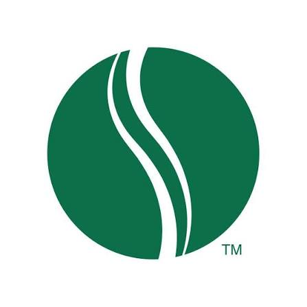

<p align="center"></p>

# Stories Coffee hackathon

Transaction analysis for January–June 2026. The original CSV and hackathon brief are retained at the repository root.

## Query the database

The ready-to-use **SQLite** database is [`database/stories.sqlite`](database/stories.sqlite). Download it or clone this repository, then open it in any SQLite client (for example, a desktop database browser or the `sqlite3` command line).

```sh
git clone https://github.com/kofdarc/stories-hackathon.git
cd stories-hackathon
sqlite3 -header -column database/stories.sqlite
```

```sql
SELECT branch,
       ROUND(SUM(order_revenue_cents) / 100.0, 2) AS revenue_usd,
       COUNT(*) AS orders
FROM orders
GROUP BY branch
ORDER BY revenue_usd DESC;
```

Run the eight included business queries:

```sh
sqlite3 -header -column database/stories.sqlite < database/queries.sql
```

Python can query it without installing packages:

```python
import sqlite3

with sqlite3.connect('database/stories.sqlite') as db:
    print(db.execute('SELECT COUNT(*) FROM orders').fetchone())
```

## Schema and units

| Table / view | Grain and purpose |
| --- | --- |
| `transaction_lines` | 51,177 source item lines. `line_id` is unique; `transaction_id` repeats within baskets. Money is stored as integer cents. |
| `transactions` | Same item lines, with convenient dollar columns: `unit_price_usd`, `unit_cost_usd`, `line_revenue_usd`, `line_gross_profit_usd`, and fractional `discount_rate`. |
| `orders` | 33,887 unique orders, with metadata, item counts, units, exact cent totals and dollar totals. Use for average order value and order counts. |
| `source_metadata` | CSV filename, SHA-256, row/order counts and date coverage for reproducibility. |

Common columns are `order_date` (`YYYY-MM-DD`), `order_time` (`HH:MM:SS`), `branch`, `customer_id`, and `order_type`. Item lines also have `product`, `category`, and `quantity`. A blank customer ID becomes SQL `NULL`. Timezone is not supplied by the CSV.

`discount_basis_points` stores the rate out of 10,000: `1000` means 10%. Sum integer-cent columns and divide by `100.0` for monetary reports; dollar views use SQLite floating-point arithmetic for convenience. Gross margin is total gross profit divided by total revenue, not an unweighted average of row margins.

**Do not count item rows as orders.** Use `orders` or `COUNT(DISTINCT transaction_id)`. Category/product order counts overlap when a basket contains multiple products or categories.

## Rebuild or import SQL

The database is generated from the CSV using Python 3.8+ and its standard library:

```sh
python3 database/build_database.py
```

This rebuilds the SQLite file and the complete [`database/stories.sql`](database/stories.sql) dump (schema, data, views and indexes). It validates source columns, date/time parsing, financial arithmetic, within-order metadata, totals and SQLite integrity, runs all example queries, then tests restoration from the dump. Output files are overwritten; write experimental tables to a separate copy.

To build a new database directly from the SQL dump:

```sh
sqlite3 /tmp/stories-restored.sqlite < database/stories.sql
```

Use a new/empty destination for imports. The dump uses **SQLite SQL dialect**; it is not a PostgreSQL or MySQL migration. The schema alone is in [`database/schema.sql`](database/schema.sql).

## Competitor and market events

`data/external/` lists real, sourced competitor events (café openings, a Café Najjar product launch, rival Ramadan offers) and 2026 Lebanon war and ceasefire dates. `src/competitor_events.py` turns them into day-level features and tests them against daily baskets. `python3 database/add_events.py` loads them into `stories.sqlite` (`competitor_events`, `market_events`, `event_days`, and the `transactions_with_events` view) and writes [`data/stories_transactions_with_events.csv`](data/stories_transactions_with_events.csv): every transaction line plus nine event columns. No competitor event moved Stories' baskets. Baskets kept growing through the war that the café sector says cut its trade sharply. See [`data/external/EVENTS_SOURCES.md`](data/external/EVENTS_SOURCES.md).

## Reconciliation and limitations

- Revenue: **$305,925.14**. Recorded gross profit: **$179,430.49**. Orders: **33,887**. Item lines: **51,177**.
- All original rows are preserved, including 132 exact repeated rows representing $741.43 revenue. Confirm whether these are valid repeated items or import duplicates before removing them.
- Customer IDs are absent on 36.5% of orders. Identified-customer repeat behavior cannot be generalized to anonymous customers.
- Gross profit excludes rent, payroll and other unavailable operating expenses; it is not net profit.
- Revenue and gross profit are imported as supplied, with a one-cent tolerance for source arithmetic checks. No source prices, costs or discounts are inferred or changed.
