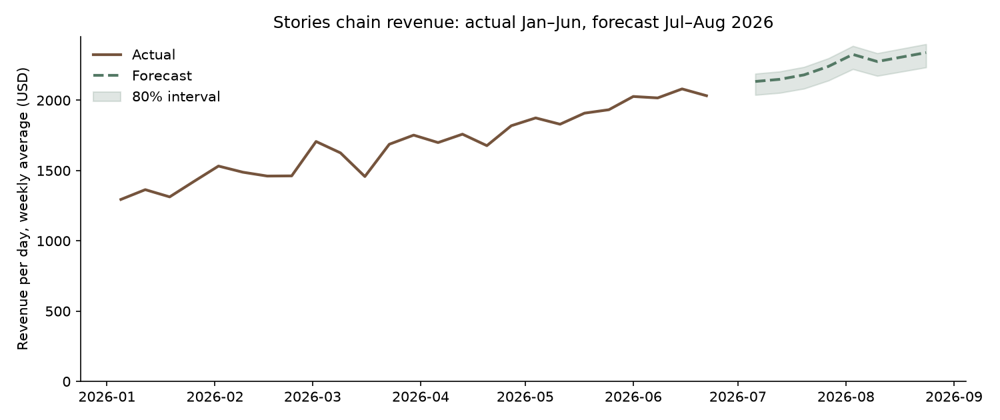

# Sales forecast: July–August 2026

**Stories should plan for about $67,350 revenue in July and $70,602 in August if the January–June growth path continues.** That is $2,173 and $2,277 a day, against $2,088 a day in June. Gross profit follows at about $39,548 and $41,461. The forecast is a continuation of the observed trend, not a prediction that the trend will hold: six months of history cannot detect seasonality, saturation or a summer slowdown.

## Forecast

| Month | Revenue (80% band) | Gross profit | Baskets | Growth per day vs prior month |
|---|---|---|---|---|
| 2026-07 | $67,350 ($64,328–$69,096) | $39,548 | 7,480 | +4.0% |
| 2026-08 | $70,602 ($67,434–$72,432) | $41,461 | 7,835 | +4.8% |

By branch (revenue):

| Branch | 2026-07 | 2026-08 |
|---|---|---|
| Garden | $21,754 | $22,782 |
| Harbour | $33,791 | $35,553 |
| Uptown | $11,804 | $12,267 |

Daily branch forecasts with 80% intervals are in `tables/forecast_daily.csv`; monthly totals in `tables/forecast_monthly.csv` and `tables/forecast_branch_monthly.csv`. The chart of revenue per day (weekly average) is `figures/forecast.png`.

## Which model, and how well it works

Six models were compared with a rolling-origin backtest: seven forecast origins every 14 days from 1 March, each trained only on earlier days and scored on the following 28 days, for every branch and day.

| Target | Model | Daily WAPE | Weekly WAPE | Bias | Skill vs seasonal naive |
|---|---|---|---|---|---|
| baskets | Linear trend × weekday | 9.4% | 3.2% | +0.3% | +16.9% |
| baskets | Ensemble (mean of models) | 9.4% | 3.2% | +1.1% | +16.6% |
| baskets | Poisson GLM (regularized) | 9.6% | 3.6% | +1.7% | +15.1% |
| baskets | Clock template (log-linear) | 9.7% | 3.7% | +2.3% | +14.5% |
| baskets | Gradient-boosted hybrid | 9.8% | 3.3% | +1.2% | +13.4% |
| baskets | Seasonal naive (last 4 weeks) | 11.3% | 7.4% | -7.0% | +0.0% |
| gp | Linear trend × weekday | 11.3% | 4.3% | +0.4% | +14.5% |
| gp | Poisson GLM (regularized) | 11.5% | 4.2% | +1.6% | +13.5% |
| gp | Ensemble (mean of models) | 11.5% | 4.3% | +1.0% | +13.5% |
| gp | Clock template (log-linear) | 11.5% | 4.4% | +2.3% | +13.1% |
| gp | Gradient-boosted hybrid | 11.9% | 4.5% | +1.1% | +9.9% |
| gp | Seasonal naive (last 4 weeks) | 13.3% | 8.2% | -7.0% | +0.0% |
| revenue | Linear trend × weekday | 11.2% | 4.0% | +0.5% | +14.7% |
| revenue | Poisson GLM (regularized) | 11.3% | 3.9% | +1.6% | +14.1% |
| revenue | Ensemble (mean of models) | 11.3% | 3.9% | +1.1% | +13.8% |
| revenue | Clock template (log-linear) | 11.5% | 4.2% | +2.4% | +13.0% |
| revenue | Gradient-boosted hybrid | 11.9% | 4.2% | +1.1% | +9.8% |
| revenue | Seasonal naive (last 4 weeks) | 13.2% | 8.0% | -7.0% | +0.0% |

- **The machine-learning models beat the standard retail benchmark by 15%–17% on daily error.** The benchmark (average of the last four same weekdays) lags a growing business: its bias is -7.0%. Weekly errors fall to about 4% because day-to-day noise cancels.
- **Simple structure wins; boosting adds nothing.** Every model sees the same branch × weekday × trend information, and gradient boosting on the residual does no better, which matches the earlier finding that this leaves only Poisson arrival noise (`feature_loop.md`). Selected: baskets: Linear trend × weekday, gp: Linear trend × weekday, revenue: Linear trend × weekday.
- **Growth is additive, not compounding.** The log-link models (clock template, Poisson GLM) over-forecast by +1.6% to +2.4% because a log trend compounds. The linear-trend model, which adds a fixed amount per month, has a bias of +0.5%. Expect the gap to widen at longer horizons.
- **Error does not grow much across the 28-day horizon** (revenue WAPE week 1: 11.2%, week 2: 11.6%, week 3: 10.9%, week 4: 11.3%). August lies beyond the tested horizon; treat its band as optimistic.

## How to use it

- **Staffing and ordering:** use the weekly totals with the 80% band. Daily branch numbers carry about ±9% error, mostly irreducible arrival noise.
- **Budget:** use the low end of the monthly band as the planning case until July actuals confirm the trend.
- **Re-fit monthly:** run `python scripts/forecast.py` after each month closes. If actuals fall below the low band two weeks running, the growth path has broken; stop extrapolating and investigate.

## Limits

- Six months of history: no yearly seasonality can be learned, and summer tourism, Ramadan timing and price changes are not modeled.
- Intervals are calibrated on the same backtest used to pick the model, so true coverage is likely a little below 80%.
- Weather and holiday features were excluded because they made the earlier holdout forecast worse (`external_factors.md`). Transaction IDs begin with `SYN-`; confirm the data reflects real trading before using the forecast for commitments.
